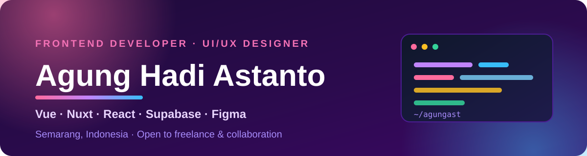

  

  

---

### 🌈 About Me

| 🎓 Currently | 🚀 Open to | 💡 Ask me about |
| :---: | :---: | :---: |
| **Frontend Developer Intern** Politeknik Negeri Semarang | **Freelance** & collaboration | **Vue, Nuxt, React** UI/UX & Supabase |

---

### 🎨 Featured Work

#### 🚀 [Magyasaka-Web](https://github.com/agungast/Magyasaka-Web)
Portal akademik kelas TI-A: pengumuman, jadwal, tugas & ujian, pengurus, galeri, dan proyek.

  
  

#### 🧪 [Takt-Vibe-App](https://github.com/agungast/TaktVibeApp)
Aplikasi task CRUD untuk belajar Nuxt 3 dan Supabase, dari form input sampai daftar tugas.

  
  

#### ⚡ [technical-test-frontend](https://github.com/agungast/technical-test-frontend)
Halaman login dengan validasi email dan password, dibangun dengan React dan Vite.

  
  

---

### 💻 Tech Stack

**Frontend**

  
  
  
  
  
  
  
  
  

**Backend & Data**

  
  
  
  
  

**Design**

  
  

Also comfortable with Python, Dart/Flutter, and Jupyter Notebook.

---

### 📊 GitHub Analytics

  
  

---

### 🐍 Contribution Snake

  <picture>
    <source media="(prefers-color-scheme: dark)" srcset="https://raw.githubusercontent.com/agungast/agungast/output/github-contribution-grid-snake-dark.svg" />
    <source media="(prefers-color-scheme: light)" srcset="https://raw.githubusercontent.com/agungast/agungast/output/github-contribution-grid-snake.svg" />
    
  </picture>

---

### 🎮 Play Tic-Tac-Toe!

Kamu ❌, komputer ⭕. Klik sel kosong untuk jalan — setiap klik membuka issue yang langsung diproses dan ditutup bot.

<!-- tictactoe start -->
<!-- board: X---O---- -->

  <b>Giliran kamu (❌).</b> 
     
     
    

<a href="https://github.com/agungast/agungast/issues/new?title=ttt%7Creset">🔄 Mulai ulang</a>

<!-- tictactoe end -->

---

  <b>Let's build something together.</b>

  
  
  
  
  

  

